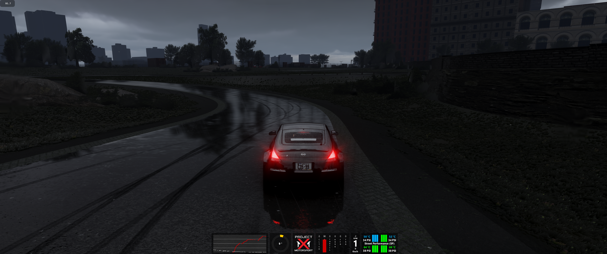

# Drift Follow Camera for Assetto Corsa

A chase camera built for drifting: follow the slide, see the road ahead and keep the horizon steady. Choose a responsive driving preset or a slower cinematic preset, then tune the framing to your car and screen.

Drift Follow adds a new choice in Custom Shaders Patch. Basic, Arcade and Drone remain available. It uses AC's existing chase-camera slots rather than adding another camera mode.



*Real in-game capture: CW 350Z 2JZ-GTE, Brooklyn Park, Heavy Rain, approximately 25 mm/h. The car is stopped; this image shows framing, not motion or a performance benchmark. Weather, lighting and car assets come from the user's installation.*

## What it feels like

The camera blends the car's heading with its forward direction of travel. As the rear steps out, the view rotates towards the slide instead of staying rigidly behind the body. Adjustable look-ahead shifts the aim slightly towards the road. Rotation is damped over time, and body roll can be almost entirely removed from the horizon.

At low speed or in reverse, slide tracking fades away. That helps avoid the abrupt orbit that can happen when velocity flips direction during a spin. Resets, car changes, chase-slot changes and replay discontinuities clear the camera's old motion state.

This is a camera effect. It does not change steering, tyres, force feedback, physics, weather or graphics settings.

## Requirements and compatibility

- Assetto Corsa on Windows.
- Content Manager with Custom Shaders Patch installed.
- A CSP build that supports scripted chase cameras and the replay/car-jump callbacks used here.

The camera has been driven on CSP **0.3.0-preview649** with the **CW 350Z 2JZ-GTE at Brooklyn Park**, on a single 3440 × 1440 display. Source checks use Lua 5.1 with a CSP API double. Older CSP builds, VR, triples, online sessions and the full range of replay operations have not all been validated in-game. No minimum supported CSP version is claimed.

Pure is **not required**. The screenshot's rain and lighting are separate from the camera.

## Install

1. Close the AC driving session.
2. Download/extract this repository or a built installation ZIP.
3. Copy the **contents of `extension/`** into the AC installation's `extension/` folder. A typical game root is `C:\Program Files (x86)\Steam\steamapps\common\assettocorsa`.
4. Confirm the installed path is `assettocorsa/extension/lua/chaser-camera/drift-follow/camera.lua`. The `drift-follow` folder contains exactly `camera.lua`, `manifest.ini` and `settings.ini`.
5. In Content Manager, open **Settings → Custom Shaders Patch → Chase Camera**. Enable the extension and select **Drift Follow** as the script.
6. Start a session and switch to an existing chase view. Tune the script settings on that CSP page.

Copy the folder into the game root, not into `Documents/Assetto Corsa`, and do not leave an extra repository-name folder around it. Pure, CSP binaries, purchased assets and dependencies are not bundled.

## Start here

The default Driving setup uses **6 m distance, 1.8 m height and 50° FOV**, with **65% slide follow** and **95% horizon stability**. Try it on a familiar car before changing several options together.

For more responsive framing, reduce **Smoothing multiplier**. For more visible slide rotation, raise **Slide following strength**. To keep the car more rigidly framed, lower that strength. Change distance and FOV separately: moving back changes perspective and car size, while increasing FOV widens the lens and can exaggerate depth.

## Every setting explained

### Preset — `PRESET`

Default **0 / Driving**; **1 / Cinematic**.

Driving uses a 0.14-second yaw response constant and 0.18-second slope response constant. Cinematic uses 0.30 seconds for both, adds **0.6 m distance** and **0.15 m height**, and subtracts **4° FOV**. These response constants are multiplied by Smoothing; they are not fixed delays before the camera begins to move.

With untouched defaults, Cinematic therefore uses **6.6 m, 1.95 m and 46°** in the near chase slot. It does not change simulation speed or automatically switch shots.

### Camera distance — `DISTANCE`

Default **6 m**; range **3–12 m**; step **0.1 m**.

Horizontal distance behind the camera's blended heading, measured from the car transform origin. Larger values show more surroundings and make the car smaller. Cinematic adds 0.6 m. The far chase slot adds another 1.5 m.

### Camera height — `HEIGHT`

Default **1.8 m**; range **0.7–4 m**; step **0.1 m**.

Vertical offset above the car transform origin on level ground. It is not an exact ground-to-camera measurement because car origins and terrain differ. Slope follow adjusts the result on hills. Cinematic adds 0.15 m; the far chase slot adds another 0.25 m.

### Field of view — `FOV`

Default **50°**; range **35–95°**; step **1°**.

Passed to CSP's camera FOV field. Lower values give tighter framing; higher values show more of the surroundings. Cinematic subtracts 4° before clamping the final value to 35–95°. The screen aspect ratio also affects what is visible.

### Slide following strength — `SLIDE_FOLLOW`

Default **0.65 / 65%**; range **0–1**.

How much of the slip-angle offset influences camera rotation. Zero follows body heading. One uses the full permitted angle, with speed and forward-motion fade still applied. The maximum-angle setting limits the input **before** multiplying by this strength.

### Maximum slide-follow angle — `MAX_SLIDE_ANGLE`

Default **60°**; range **0–85°**.

Caps the horizontal angle between body heading and velocity used by slide tracking. At default strength and sufficient forward speed, the maximum slide-induced camera yaw is approximately **60° × 0.65 = 39°**. Manual look is a separate input.

### Smoothing multiplier — `SMOOTHING`

Default **1**; range **0.35–2.5**; step **0.05**.

Multiplies the preset's yaw, look-ahead and slope response times. Smaller values settle faster; larger values settle more slowly. Exponential smoothing keeps the response consistent across frame rates. This setting smooths framing; it does not add a spring or collision avoidance.

### Look-ahead — `LOOK_AHEAD`

Default **1 m**; range **0–3 m**; step **0.1 m**.

Moves the point the camera aims at towards the blended travel direction. It fades out at low speed, in reverse and during manual looking. The vertical aim point is fixed at 0.65 m above the car origin.

### Horizon stability — `HORIZON_LOCK`

Default **0.95 / 95%**; range **0–1**.

Blends body-up with world-up. At one, the camera removes body roll from the horizon. At zero, the up vector follows the car's roll. The final vector is projected perpendicular to the viewing direction so the camera basis stays valid even during large rolls.

### Slope follow — `SLOPE_FOLLOW`

Default **1 / 100%**; range **0–1**.

Adjusts camera height using the car's pitch and the camera's angle relative to its heading. This helps it follow hills. Zero keeps the vertical offset independent of pitch. Slope response is damped, and extreme pitch is limited internally. This is not terrain raycasting.

## How the settings combine

Near Driving uses the base distance, height and FOV. Near Cinematic applies the offsets above. Selecting Drift Follow for the second/far chase slot adds another **1.5 m distance** and **0.25 m height**, with separate motion history for each slot.

Slide tracking ramps in between **1 and 5 m/s horizontal speed** (approximately 3.6–18 km/h), and is also reduced when motion is not forwards. Manual look reduces slide tracking and look-ahead so the two systems do not fight.

Settings are read when the camera script loads. After an edit, let CSP reload the script or restart the driving session. CSP's saved script settings override defaults in `settings.ini`; changing the source defaults alone will not necessarily replace a previously saved value.

## Troubleshooting and removal

**Drift Follow is missing from the list:** check the installed folder depth and all three files, then reopen Content Manager. Confirm that scripted chase cameras work in your CSP build.

**Settings do not match this README:** inspect the script's settings in Content Manager. Back up `Documents/Assetto Corsa/cfg/extension/state/lua/chaser_camera/drift-follow__settings.ini` before removing it to reset the near-slot overrides. The second slot can have its own file under `chaser_camera_2`. Close AC first and reset only Drift Follow's files.

**The view clips through walls or scenery:** obstruction avoidance is not implemented. Increase height/distance cautiously or select another camera for confined areas.

**An old pose survives a reload or a replay looks wrong:** restart the session and report the CSP version, car, track and replay action. The source has discontinuity handling, but that is not proof of every CSP replay path working in-game.

To uninstall, select another chase script in Content Manager and remove only `extension/lua/chaser-camera/drift-follow/`. Remove the saved Drift Follow settings separately if you also want a clean reset.

## Modifying the camera

The implementation is contained in three files:

- [`camera.lua`](../extension/lua/chaser-camera/drift-follow/camera.lua) reads settings, computes the view and writes CSP camera outputs each frame.
- [`settings.ini`](../extension/lua/chaser-camera/drift-follow/settings.ini) defines the settings and their Content Manager ranges.
- [`manifest.ini`](../extension/lua/chaser-camera/drift-follow/manifest.ini) gives the camera its display name and version.

In `camera.lua`, angles are radians except FOV, while positions are metres. `sim.time` is milliseconds; frame steps and smoothing constants are seconds. The script projects velocity into the horizontal plane to compute slip. It keeps per-slot state and resets that state after teleports, car changes and clock discontinuities. Output vectors are reused rather than allocated every frame.

Change a setting's default in both the `mapSection` defaults and the corresponding `number(..., fallback)` call, then update `settings.ini`. Keep the speed/reverse fade and shortest-path angle wrapping when experimenting with rotation: removing them can cause snaps around ±180°.

### Run source checks

From the repository root, with Python installed:

```powershell
python -m venv .venv
.venv\Scripts\python.exe -m pip install -r requirements-dev.txt
.venv\Scripts\python.exe tests/run_lua_tests.py
```

The **20 camera checks** exercise the actual Lua implementation with simulated CSP calls: defaults, mirrored slides, frame-rate response, reverse, spins, manual look, resets, replay changes, slopes, both slots, Cinematic and valid camera vectors. They do not render AC or measure camera feel and frame time.

### Build an install ZIP

```powershell
python tools/build.py
```

This creates `dist/drift-follow-camera-v0.1.zip` with game-root-relative paths, this README and license notices. No game runtime is needed to build it.

## Screenshots and validation

The included screenshot is a real framing reference, not a demonstration of transitions. A daytime mid-drift image and a short Driving/Cinematic comparison clip would best show the camera's character. Capture the same car, track, date, weather, time and camera settings when comparing changes.

## License

[PolyForm Noncommercial License 1.0.0](../LICENSE.md). Noncommercial use, modification and sharing are permitted under its terms. Commercial use, including paid products incorporating this software, requires a separate permission from the licensor. This is source-available software. See [NOTICE.md](../NOTICE.md) for third-party product and screenshot notices.
